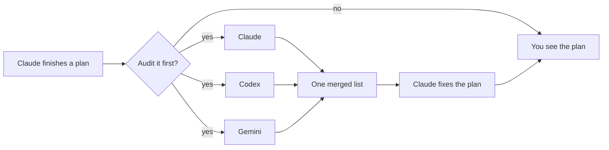

<h1 align="center">Plan Mode Crosscheck</h1>

<p align="center"><b>A second opinion before you say yes.</b></p>

<p align="center">
  Claude finishes a plan. Other models tear it apart. You see the plan after.
</p>

<p align="center">
  
  
  
  
  
</p>

Plan Mode Crosscheck is a Claude Code plugin. When Claude finishes a plan, it
asks you one question: audit it first? Say yes, and Claude, Codex and Gemini
review the plan against your real repo, all at the same time. Claude merges
what they found into one list, fixes the plan, and only then shows it to you.



## Three opinions. One plan.

**Different models, different blind spots.** Each engine runs in its own
process with its own model and a fresh context. None of them sees how Claude
reasoned its way to the plan, so they catch what it didn't think to mention.

**In parallel, not in line.** All three run at the same time, in the
background. Three reviews take as long as the slowest one, and you keep
working while they run.

**One engine down? The rest carry on.** Out of quota, not signed in, timed
out: you get the reports that did come back, and a note saying which engine
failed and why. If every engine fails, you still get your plan. You're never
stuck waiting on a broken tool.

**Three today, more tomorrow.** The engine list is a plain list, not three
hardcoded slots. Today that's Claude, Codex and Gemini; more models and more
CLIs can join in future versions without changing how you use it.

**Any model, no plugin update.** Pick a model from the shortcuts or type any
exact model ID. When a new model ships, you just pick it.

## Two ways to use it

**Automatic.** Every time Claude tries to leave Plan Mode, the plugin stops it
once and asks you whether to audit. Yes runs the audit; no shows the plan as
is. If the plan changes, you're asked again: an approval never carries over to
a plan that's since been edited.

**On demand.** Type `/crosscheck` any time to get a second opinion on whatever
you're discussing right now. No plan needed.

After each round you see every finding, one by one, most severe first, with a
recommendation: one more round, or show the plan. Nothing loops on its own:
another round always waits for your answer.

## Get started

```bash
claude plugin marketplace add https://github.com/icarloscornejo/plan-mode-crosscheck.git
claude plugin install plan-mode-crosscheck@plan-mode-crosscheck
```

Then, inside Claude Code:

```
/crosscheck-setup
```

Pick your engines, a model and an effort for each, and you're done. Run it
again whenever a new model ships. Out of the box, before setup, only Codex
audits.

## Engines

| Engine | Needs | Runs as |
|---|---|---|
| **Claude** | The `claude` CLI | A separate `claude -p --safe-mode`, read-only tools only, fresh context |
| **Codex** | [Codex CLI](https://github.com/openai/codex), signed in with ChatGPT | `codex exec` in a read-only sandbox |
| **Gemini** | The Antigravity CLI (`agy`), signed in with Google AI Pro | `agy` in read-only plan mode with its sandbox |

You only need the CLIs of the engines you pick. The plugin itself also needs
`jq` and a `timeout` command (`brew install coreutils` on macOS gives you
`gtimeout`, which the plugin finds on its own).

**Gemini setup:** run `agy` once and sign in, then check with `agy models`.
On macOS its login lives in the keychain, so over ssh it may say
"authentication required": run it from a local session or a tmux started from
the desktop.

**How read-only is read-only?** Codex runs in an OS sandbox. The Claude and
Gemini engines are not isolated like Codex: Claude is read-only because it
only gets `Read`, `Grep` and `Glob`, and `agy` still loads your own MCP
servers, extensions and rule files, since it has no flag to turn them off.
Details in [How it works](docs/how-it-works.md#how-isolated-each-engine-is).

## Troubleshooting

**Claude never asks me to audit.** Check that `claude plugin list` shows
`plan-mode-crosscheck` enabled. After changing `hooks/hooks.json`, run
`/reload-plugins` or restart.

**Codex failed.** Look at `auth=` on its line in `logs/crosscheck.log`.
`NOT_LOGGED_IN` means `codex login status` needs attention. A timeout means it
ran out of time: pick a lower effort or raise `CROSSCHECK_TIMEOUT`.

**Gemini failed.** The `reason=` on its log line is `agy`'s own message.
"authentication required" means signing in again, or not running it over ssh
(see Gemini setup above). A timeout works like Codex's.

**It keeps asking me to audit.** Each question is tied to the exact plan text.
If the plan changed, it's a new plan and a new question. If it denies without
ever asking, the `crosscheck` skill isn't being invoked: look for a background
`Bash` task with a descriptive label.

**I want it off for a while.** Create `state/DISABLED` in the plugin's state
folder. `/crosscheck` keeps working. See
[Configuration](docs/configuration.md#kill-switch).

## Learn more

- [How it works](docs/how-it-works.md): the hook and skills, failure handling,
  review rounds, scoped rounds and their measurements, and why it audits the
  finished plan.
- [Configuration and reference](docs/configuration.md): saved config,
  environment variables, where logs live, privacy, metrics, the kill switch
  and the selftest.
- [Changelog](CHANGELOG.md)

## Your plans stay yours.

Prompts never go in process arguments, everything the plugin writes is
private to your user (`0600`), staged prompts are cleaned up (Gemini's right
after its run, the rest within 7 days), and the metrics keep counts only, never
what a finding said.

---

<p align="center"><sub>MIT licensed.</sub></p>
